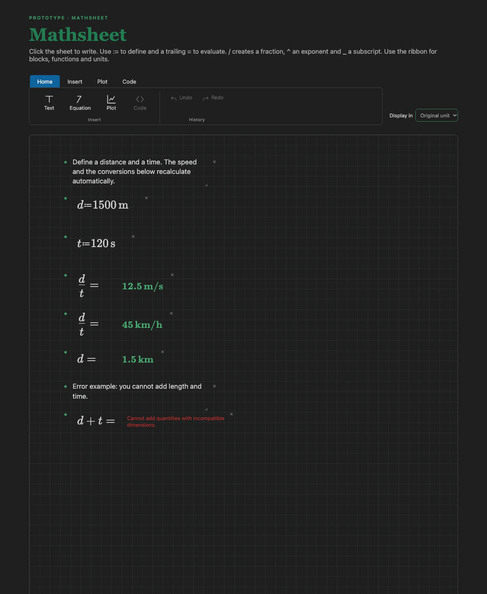
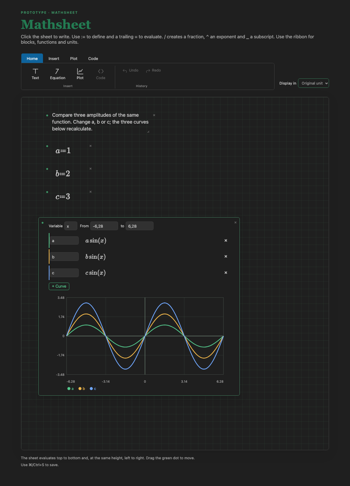

# Mathsheet — an executable mathematical document

> Proposal and validation log. The spatial sheet already accepts definitions, quantities with units, conversions and calculations directly in the edited expressions. The following sections describe the broader direction of the product.

The name **Mathsheet** joins *math* + *sheet*: a sheet where you write mathematics and the result appears in the same place. The document remains a `.mathdoc`, opened by the **Mathsheet** editor that the extension registers.

- Extension ID: `lgili.mathsheet` (publisher `lgili`; not on the Marketplace yet).
- Main command: **Mathsheet: New sheet**.
- Editor: **Mathsheet**, associated with `*.mathdoc` files.
- Structure: `src/extension.js` (VS Code host), `engine/canvas-core.mjs` (sheet engine), `engine/core.js` (numeric engine), `engine/kernel/runner.py` (Python), `media/` (webview), `examples/` and `test/`.

## Install

From a `.vsix` built in this repository:

```bash
npm install
npm run package
code --install-extension mathsheet.vsix
```

Then open any `*.mathdoc` file, or run **Mathsheet: New sheet** from the command palette. The extension is not on the Marketplace yet; the publisher is `lgili` and the extension id is `lgili.mathsheet`.



## Current prototype: writing and calculating on the sheet

Click an empty spot to create a mathematical region. Typing is formatted on the sheet itself by [MathLive](https://mathlive.io/mathlive/): `^` creates an exponent, `/` creates a fraction and `_` creates a subscript. Write `a:=20` to define `a`, `b:=4` in another region and `(a+b)/2=` to get `12`. Changing `a` to `30` updates the result to `17`. The expression that appears in the editor is the input interpreted by [Compute Engine](https://mathlive.io/compute-engine/guides/latex-syntax/).

The sheet evaluates expressions **from top to bottom and, at the same height, from left to right**. Moving a region can change the dependencies. An invalid definition does not keep old values; the calculations that follow show the symbol that needs to be defined. `:=` defines a variable; a trailing `=` requests the value; a complete equality, such as `a=20`, is not resolved yet.

### Plots on the sheet

Use **+ Plot** to insert a plot region after the existing blocks. Each curve has a name and an editable mathematical expression; **+ Curve** lets you compare up to six expressions on the same axis. The range and the horizontal variable are edited in the block itself. The plot is recalculated when a definition above it changes and stays saved inside the same `.mathdoc`.

Open `examples/plot-canvas.mathdoc` to compare `a sin(x)`, `b sin(x)` and `c sin(x)` with three amplitudes. Change `b:=2` to `b:=4` and watch only the corresponding curve. In this first version, the axes and the expressions in the plot are **dimensionless**; plots of quantities with units still require a definition of scale and of axis presentation.



### Units in the prototype

On the sheet, select an equation and choose a unit in the **Insert unit** control. The unit is inserted at the cursor and appears formatted as mathematics. For example, define `d:=1500 m` and `t:=120 s`; `d/t=` shows `12.5 m/s`. The file `examples/units-canvas.mathdoc` also shows a conversion to `45 km/h` and another to `1.5 km`. The last expression tries to add length and time and displays a dimensional error. To convert, select an equation and choose the desired unit in **Display in**. The mathematical expression remains readable; the conversion stays associated with the sheet region.

### How to run

1. Open this folder in VS Code and run `npm install` in the folder's terminal.
2. Press **F5** and choose **Mathsheet: development extension (F5)**. The launch task runs `npm run build` and opens `examples/plot-canvas.mathdoc`.
3. If the file appears as JSON, use **View: Reopen Editor With... → Mathsheet**.
4. Edit `b:=2` to `b:=4`: the second curve should double its amplitude; the other two stay the same. To test units, open `examples/units-canvas.mathdoc`.
5. Click an empty spot, type another expression and try fractions and exponents. Save with **⌘/Ctrl+S**.
6. Run `npm run verify` to run everything: the tests of both engines, the check of the examples and the verification of the interface. Use **Mathsheet: New sheet** in the command palette to create another spatial sheet.
7. `npm test` runs only the automated tests. `npm run verify:ui` loads the webview scripts in a browser and drives typing, dragging, plots and units the way a person would — it needs Chrome, Chromium, Edge or Brave; with none of them, it warns and does not fail.
8. After experimenting on the examples, `npm run examples:reset` returns the three spatial-sheet examples to the state described here, and `npm run examples:check` only reports whether any of them left that state.

The spatial-sheet examples are generated by `tools/make-examples.mjs`, which also checks against the engine the numbers promised in this README. `examples/plot-canvas.mathdoc` demonstrates three curves. `examples/units-canvas.mathdoc` demonstrates units. The example `examples/spatial-worksheet.mathdoc` keeps the earlier free-typing experiments and may contain changes made during tests. The earlier numeric example is in `examples/calculated-canvas.mathdoc`. The initial block-based sheet is still in `examples/first-worksheet.mathdoc`.

### What was verified

- In the VS Code interface, the earlier numeric example opened with `a:=20`, `b:=4` and result `12`.
- Editing `a:=20` to `a:=30` directly changed the result on the same sheet to `17`. Restoring `20` brought `12` back.
- The forty-one automated tests pass and cover calculation, spatial order, updating, plots, scope of the horizontal variable, quantities, conversions, dimensional errors, a misspelled unit, conversion to a nonexistent unit, the validation of the document that the webview returns and the Python bridge (scalars, session state, print capture, errors and reserved names).
- `npm run verify:ui` loads the webview scripts (MathLive, the engine bundle, `media/canvas.js`, `media/plot.js`, `media/ribbon.js` and `media/worksheet.js`) in a headless browser and drives seventeen behaviors: typing `a:=30` takes the average to `17` and **Undo** takes it back to `12`; typing re-enables Undo; **Redo** reapplies it; after dragging a block, the first Undo reverts the typing and the second reverts the drag; the plot draws one curve per series; the range is saved as a number; a result with a unit appears formatted; a misspelled unit shows the diagnostic on the sheet and on a curve; and the ribbon exposes its four tabs and the function/unit gallery. The browser assembles the same pages that the extension assembles, so the behavior is the same, but the VS Code host, the CSP and saving to disk do not go through that path.
- In that verification a defect appeared that has already been fixed: **Undo** stayed disabled when the first change was typing, because `media/worksheet.js` re-enables the button by identifier and the spatial sheet's button did not have that identifier.
- The message that the webview sends to VS Code goes through `document-schema.js` before touching the file: format, version, layout, block types, size limits and repeated identifiers. A rejected change now warns on the sheet instead of failing silently. The tests cover that path with a simulated VS Code: an invalid document does not write to the file, a valid document is applied, the editor echo becomes a confirmation and closing the panel discards the listeners.
- A conversion target coming from the file, such as `"convertTo": "foobar"`, is rejected with `Unknown unit`, since that name does not go through typing and would not be caught by the LaTeX check.
- The examples were checked against the engine: `examples/plot-canvas.mathdoc` has three curves with peaks `1`, `2` and `3`, and changing `b:=2` to `b:=4` doubles only the second; `examples/calculated-canvas.mathdoc` has `a:=20`, `b:=4` and average `12`, and `a:=30` takes the average to `17`.
- The bundle that the webview loads was executed over the three examples: units, conversions and curves match the values described above.
- A misspelled unit, such as `2 foobar`, appears as `Unknown unit: foobar.` instead of asking for the definition of a variable.
- The spatial sheet engine is in `engine/canvas-core.mjs`; `npm run build` bundles it for the webview. `media/canvas.js` handles the interaction; `extension.js` integrates saving and opening with VS Code.

### Current limits

At this stage the calculation accepts **finite real** results, with or without units recognized by the engine. Undefined symbols, an incomplete expression, division by zero and a complex result appear as diagnostics. There are still no user-defined functions, equation solving, programming, Jupyter kernel or publishing. Plots accept only real values without units at this stage. Insertion and conversion from the list include the usual units; additional units and a broader contextual choice still need work. Free positioning also requires tests of alignment, overlap, navigation and keyboard use. The sheet's undo/redo groups typing into one entry per editing session in each field, but MathLive's internal undo is not yet integrated with that history.

MathLive (`0.111.1`) and the Compute Engine are installed as local dependencies; their exact versions are listed in `package-lock.json`. [MathLive uses the MIT license](https://github.com/arnog/mathlive).

## 1. Idea

Create a generic environment for thinking, calculating, experimenting and communicating with mathematics. The writing experience starts from a mathematical sheet close to the Mathcad reference, with the ambition of computational exploration that motivated the reference to Wolfram notebooks.

The user works with text, equations, units, tables and plots. They can develop problems in mathematics, physics, engineering, statistics or other areas without having to program to carry out the basic operations.

The first interface will be **a visual editor of our own inside VS Code**, installed as an extension. The document and the calculation engine must remain independent of that interface, allowing a dedicated application or another interface in the future.

**Central question:** how can you write mathematics on the computer with the freedom to develop an argument on paper, gaining calculation, experimentation and publishing in the same place?

## 2. Experience we want to validate

A person opens an empty document, writes an explanation and inserts:

```text
v₀ := 20 m/s
 g := 9,81 m/s²
h(t) := v₀·t − g·t²/2
h(1 s) = 15,095 m
```

In the editor, the expressions appear as editable mathematics: fractions, exponents and subscripts. The example above is only a textual representation of the intent, not a syntax that has already been defined.

The person changes `v₀`, watches the result update and inserts a plot of `h(t)`. Then they write a condition, ask for a solution and record their conclusion. When publishing, they choose the relevant content and apply a consistent presentation.

The user must be able to understand the calculation and repeat the work without depending on an AI agent. Programming and AI can extend the experience, but they are optional.

## 3. Product principles

- **Editable mathematics:** edit numerators, denominators, exponents, subscripts and matrices directly. LaTeX can be an interchange format, but it must not be mandatory in order to use the editor.
- **One shared definition:** the displayed expression, the calculated expression and the exported expression derive from the same mathematical structure, avoiding the maintenance of independent versions.
- **Explicit semantics:** distinguish definition, evaluation, equality to be solved and hypothesis. Also distinguish a symbol without a value, a free variable and a nonexistent reference.
- **Visible units and conditions:** when applicable, present units, domain, constraints and hypotheses alongside the reasoning.
- **Traceable results:** show which inputs produced a result and indicate when it is out of date or when the calculation failed.
- **Reproducible document:** reopening and recalculating must produce results consistent with the recorded definitions and versions.
- **Progressive complexity:** start with simple operations and reveal advanced features as the need appears.
- **Generic application:** circuits, structures, finance or any other domain can use the environment; none of them defines the basis of the product.

## 4. Proposed architecture

```text
VS Code extension
└── Visual editor for the mathematical sheet
             ↕
Document and expression model
             ↕
Independent calculation service
└── Numeric, symbolic and unit libraries

Document model → Presentation / export
Calculation service  ↔ Jupyter adapter, if we validate that need
```

### Visual editor

Use the VS Code Custom Editor API and a webview to build the mathematical sheet. That approach offers a surface of its own for text, equations and plots; it requires implementing and validating the editing interactions.

The extension integrates file opening and saving, commands and the engine lifecycle. The interface must treat selection, keyboard, undo/redo, copy/paste, focus and accessibility as central requirements.

The page can start with blocks organized vertically and simple alignments. The need for free positioning will be assessed later, because it affects reading, the order of the calculations and pagination.

### Document model

Propose an open, versioned format, initially textual, containing blocks with stable identifiers: text, definition, evaluation, plot and others as they become necessary.

Store expressions in a structure that represents their meaning — for example, a tree of operations and symbols — instead of relying only on images or on presentation text. The concrete choice of that representation is part of the initial experiments.

Separate authored inputs from calculated results. Saved results must carry state and a link to the inputs that produced them; an old result must not look up to date.

### Mathematical engine

Responsible for interpreting definitions, validating units, evaluating expressions, identifying dependencies and providing structured results or diagnostics.

Python is a candidate for hosting that service and accessing existing libraries. The mathematical interface should not have to reproduce Python syntax. Specific libraries and protocols will be chosen after small experiments.

The first engine can be a local process, with structured messages between editor and calculation. That makes it possible to test the contract without immediately requiring a kernel of its own.

### Jupyter compatibility

An adapter compatible with the Jupyter kernel protocol is one integration possibility. On its own it neither creates the visual editor nor solves the rules of dependency and recalculation.

First validate whether that integration serves a concrete use, such as running the same definitions in another interface. Sharing the engine does not guarantee preserving the whole visual experience in conventional notebooks.

### Publishing

Generate the presentation from the same mathematical document, with its own rules for pagination, typography, captions and references.

Start with a simple publishing preview. PDF and Word come in later stages, keeping equations editable where the format allows. Exporting must not change the meaning of the expressions or silently hide out-of-date results.

## 5. Initial rules to experiment with

1. The document is evaluated from top to bottom; a definition takes effect from its position onwards.
2. In the first prototype, redefining a symbol in the same scope produces a clear message. Comparisons between scenarios and scopes of their own will be studied later.
3. Changing an input invalidates the dependent results. The prototype can recalculate the whole document; optimizing only the affected parts comes later.
4. Fast calculations can update automatically. Slow operations need explicit execution, progress and cancellation.
5. An error is presented next to the expression, with a useful explanation. Dependent results stay marked as invalid or out of date.
6. Incompatible units produce a diagnostic. Automatic conversions must follow predictable rules.

These rules are experience hypotheses, not definitive language decisions.

## 6. Validation through small prototypes

Each stage must answer a question and produce something a person can try. Progress depends on the evidence obtained, with no prior commitment to a complete technology stack.

| Stage | Experiment | Evidence to move on |
|---|---|---|
| 0 — Writing | A sheet with text and one visual equation, without an engine | The person can insert and fix a fraction, exponent and subscript; navigate with the keyboard and undo without losing content. |
| 1 — Calculation | Define two variables and evaluate an expression | The result is correct; changing an input updates the calculation; missing references produce an understandable diagnostic. |
| 2 — Units and dependencies | Reproduce the motion example and introduce a unit error | The person understands the conversion, where the result came from and the error message; no old result looks valid. |
| 3 — Persistent document | Mix text and equations, save, close and reopen | Structure and editing are preserved; recalculating from a clean session reproduces the results. |
| 4 — Exploration | Insert a plot and compare three values of a parameter | The user relates input, curve and conclusion; they can pin one scenario down without accidentally changing another. |
| 5 — Publishing | Produce two pages from the work | Text, equations and figures remain readable, coherent and well paginated; the published document matches the saved calculation. |
| 6 — Generality | Repeat tasks in algebra, data and an application with units | The model supports different areas without rules specific to one field. |

### First concrete prototype

Deliver a local extension that opens a demonstration document and allows you to:

- Write a paragraph.
- Insert two numeric definitions.
- Build and edit a fraction with those variables.
- Request the evaluation and see the result on the sheet.
- Change an input and notice that the result changed.
- Save, reopen and keep editing.

Initially separate the editing test from the calculation test to identify where the difficulty lies. The first complete cycle must bring both together.

## 7. How to test with people

Invite three to five people with mathematical familiarity and different levels of programming. Ask for concrete tasks, avoiding a step-by-step demonstration before observing the first attempt.

Record:

- Time until the first correct calculation.
- How many interventions were needed and in which actions.
- Editing, selection or interpretation errors.
- Ability to explain where a result came from.
- Ability to identify an out-of-date calculation.
- Perceived quality when reading the published output.

A suggested initial target is to complete the basic task within ten minutes, without editing code and with at most one hint. That target is an experimental criterion to adjust, not a product promise.

If people can calculate but struggle to fix an equation, prioritize editing before adding solvers. If writing is pleasant but the results are confusing, review the evaluation rules and how dependencies are presented.

## 8. Decisions that deserve their own experiments

- An existing mathematical editor or a component of our own? Compare real editing, accessibility, expression format and license before choosing.
- How to distinguish definition, equality and evaluation without ambiguity?
- How to represent subscripts that are part of a variable name and subscripts that index vectors?
- How to handle the decimal comma, argument separators, Greek symbols and implicit multiplication?
- How to distinguish variables and units with similar names?
- How far to use automatic organization and when to allow free positioning?
- How to present multiple solutions, hypotheses and approximate results?
- What is the role of Python blocks and how to make their effects explicit?
- How to install and update the engine without requiring manual maintenance of the users' environments?

## 9. Later scope

Leave until after basic validation: simultaneous collaboration, cloud, a library of domain templates, marketplace, integrated AI, import of proprietary formats, a complete programming language and a standalone application.

Advanced symbolic calculation, differential equations, optimization and simulation are possible directions. They should come in as real tasks show the need.

## 10. Recommended next action

The same visual field already feeds the calculation. The experiment on **quantities with units and dimensional analysis** is already in the `examples/units-canvas.mathdoc` example: it defines length and time, calculates speed, converts units and flags an incompatible sum. There is also a recalculable plot example. The next experiment is to validate editing with users and produce a first publishable page from the sheet.

In parallel, observe users creating and fixing expressions without help. The observations should guide how alignment, navigation between regions and undo work before expanding the set of mathematical operations.

**Central criterion:** a person must be able to write, understand, change and publish a mathematical argument without having to program.

## Initial technical references

The references support the extension and communication mechanisms available. The architecture above is a proposal from the project.

- [VS Code — Custom Editor API](https://code.visualstudio.com/api/extension-guides/custom-editors): proposed basis for the visual editor of our own.
- [VS Code — Notebook API](https://code.visualstudio.com/api/extension-guides/notebook): cell-based alternative, useful for comparison and possible integrations.
- [Jupyter — Making kernels](https://jupyter-client.readthedocs.io/en/latest/kernels.html): possible integration of the engine with Jupyter clients.
- [Jupyter — Messaging](https://jupyter-client.readthedocs.io/en/latest/messaging.html): communication protocol between interfaces and kernels.
